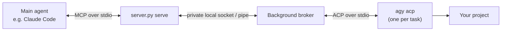

# Antigravity MCP

**Let Claude Code (or another MCP client) hand coding work to Google's Antigravity CLI on your computer, and keep a two-way conversation with it.**

Antigravity MCP is a small local MCP server. It turns the [Antigravity CLI](https://antigravity.google/product/antigravity-cli) (`agy`) on your computer into persistent coding subagents for your main AI agent:

- **Persistent conversations.** Start a task, follow its progress, send follow-ups, steer or interrupt a running turn, and resume after a restart.
- **Feels like `agy`.** The same models, thinking levels, modes (`default`, `accept-edits`, `plan`, and Auto where Antigravity offers it), custom agents, skills and slash commands such as `/compact` or `/goal`. Your `agy` settings, rules and permission rules apply unchanged.
- **Two-way communication.** When the Antigravity agent asks a question, the main agent answers it.
- **Safe approvals.** Antigravity's permission engine decides what needs approval. Nothing is approved silently: approvals go to you, or to Antigravity's own Auto mode if you choose it. The main agent may always deny.
- **Parallel work in Git worktrees.** Give each task its own worktree, then take the result as a reviewable patch.
- **Account-friendly.** Shows your remaining quota, never retries a failed turn on its own, and runs at most four Antigravity sessions at once by default.
- **No extra dependencies.** Python standard library only. Windows, macOS and Linux, local pipes and sockets only (never a network port).

It uses only interfaces that Google documents for Antigravity CLI: the [Agent Client Protocol server `agy acp`](https://antigravity.google/docs/cli/acp) (the same interface that Zed, JetBrains IDEs and Xcode use) and [headless mode](https://antigravity.google/docs/cli/headless). It never touches your Google sign-in. See [Terms of use](#terms-of-use).

## Contents

- [Requirements](#requirements)
- [Installation](#installation)
- [Your first task](#your-first-task)
- [Approvals and questions](#approvals-and-questions)
- [Terms of use](#terms-of-use)
- [Updating and uninstalling](#updating-and-uninstalling)
- [Troubleshooting](#troubleshooting)
- [How it works](#how-it-works)
- [Documentation](#documentation)
- [Development](#development)

## Requirements

| You need | Version | Check with |
|---|---|---|
| Python | 3.11 or newer | `python3 --version` (Windows: `py -3 --version`) |
| Antigravity CLI | 1.5.0 or newer (tested with 1.5.13) | `agy --version` |
| An Antigravity sign-in | Google account, Gemini Enterprise, Gemini API key or Google Cloud credentials | run `agy` once |
| An MCP client | Claude Code, Claude Desktop, or another stdio client | |
| Git (only for worktrees) | 2.36 or newer | `git --version` |

**Antigravity CLI must be installed and signed in on the same computer and under the same OS account that runs the MCP server.** The server starts `agy` as that account, and `agy` uses the sign-in cached there.

## Installation

The steps below use Claude Code. For other clients, see [Step 5](#step-5-connect-your-mcp-client) and [docs/installation.md](docs/installation.md).

### Step 1: Install Python

- **Windows:** install Python 3.11+ from [python.org](https://www.python.org/downloads/) and tick **Add python.exe to PATH**. This also installs the `py` launcher used below.
- **macOS:** `brew install python`, or the installer from python.org.
- **Linux:** your distribution's package, for example `sudo apt install python3`.

### Step 2: Install and sign in to Antigravity CLI

Follow [Google's quickstart](https://antigravity.google/docs/getting-started). In short:

macOS / Linux:

```bash
curl -fsSL https://antigravity.google/cli/install.sh | bash
```

Windows (PowerShell):

```powershell
irm https://antigravity.google/cli/install.ps1 | iex
```

Then open a **new** terminal, run `agy` once and sign in. Over SSH, `agy` prints a link and asks for a code; alternatively run `agy acp --login`. Check:

```bash
agy --version
```

### Step 3: Download Antigravity MCP

Get the code from the [antigravity-mcp repository](https://github.com/houyhlouis/antigravity-mcp) and keep the folder in a permanent place (for example `~/tools/antigravity-mcp` or `C:\Tools\antigravity-mcp`), because your MCP client runs the server from there.

```bash
git clone https://github.com/houyhlouis/antigravity-mcp.git
cd antigravity-mcp
```

Or download **Source code (zip)** from the [latest release](https://github.com/houyhlouis/antigravity-mcp/releases/latest) and extract it. Nothing has to be installed after downloading.

### Step 4: Check that it works

In the `antigravity-mcp` folder:

```bash
python3 server.py --version
python3 server.py doctor
```

On Windows use `py -3` instead of `python3`. `doctor` checks Python, the `agy` executable and its version, ACP support and the state folder. It starts nothing and uses no quota.

### Step 5: Connect your MCP client

**Claude Code.** Run this inside the `antigravity-mcp` folder.

macOS / Linux:

```bash
claude mcp add --transport stdio --scope user antigravity -- python3 "$PWD/server.py" serve
```

Windows (PowerShell):

```powershell
claude mcp add --transport stdio --scope user antigravity -- py -3 "$PWD\server.py" serve
```

Check with `claude mcp list` or `/mcp` inside Claude Code: `antigravity` should be connected.

**Claude Desktop and other clients.** Add this to the client's MCP configuration and restart it:

```json
{
  "mcpServers": {
    "antigravity": {
      "command": "python3",
      "args": ["/absolute/path/to/antigravity-mcp/server.py", "serve"]
    }
  }
}
```

On Windows use `"command": "py"` and `"args": ["-3", "C:\\Tools\\antigravity-mcp\\server.py", "serve"]`. Ready-made files: [examples/mcp.json](examples/mcp.json) and [examples/mcp.windows.json](examples/mcp.windows.json).

### Step 6 (optional): Teach your agent the workflow

Copy [examples/CLAUDE.md](examples/CLAUDE.md) into your project's `CLAUDE.md` (or your agent's instructions). It explains polling, questions, approvals and worktrees.

No configuration file is needed. Optional settings are described in [docs/configuration.md](docs/configuration.md).

## Your first task

Ask your main agent in plain language:

```text
Use Antigravity in this project to find out why the tests fail and fix them.
Keep me updated and answer its questions.
```

```text
Start two Antigravity tasks in separate worktrees: one tries approach A, the
other approach B. Show me both patches when they are done.
```

```text
Continue the same Antigravity conversation: add a --json flag and run the tests again.
```

Behind the scenes the main agent starts work with `agy_start`, polls `agy_events` until the turn ends, answers questions with `agy_respond`, shows approvals to you with `agy_review_request`, and reads the result with `agy_get`. See the [usage guide](docs/usage.md).

## Approvals and questions

Antigravity asks before actions that its [permission rules](https://antigravity.google/docs/permissions) do not allow, for example most terminal commands in `default` mode. The server turns each prompt into a pending request:

| Who | May |
|---|---|
| The main agent | Always **deny**. Answer the Antigravity agent's **questions** |
| You | **Allow** or deny, in your MCP client's prompt (`agy_review_request`) or in a terminal: `python3 server.py review REQUEST_ID` |
| Antigravity's Auto mode (`mode: "auto"`) | Let Antigravity's own reviewer decide, where Antigravity offers Auto mode |

The main agent can approve only if you set `approval_relay = true` in the [settings file](docs/configuration.md). The server never uses `--dangerously-skip-permissions`. To get fewer prompts, add allow rules in Antigravity (`/permissions`) or use `mode: "accept-edits"`.

## Terms of use

You use Antigravity under [Google's terms](https://antigravity.google/terms), and you are responsible for what the agents you start do. This project is designed to stay inside them:

- It runs only the official `agy` program through interfaces that Google documents for third-party clients ("Any ACP client can launch Antigravity CLI"), and identifies itself honestly as `antigravity-mcp`.
- It never reads, copies or uses your sign-in token, never calls Google's services directly, and never signs in or out for you.
- It respects Antigravity's permission engine and your account limits (see [Limitations](docs/limitations.md)).

Google's Additional Terms of Service for Antigravity also say that "using third party software, tools, or services to access the Service (e.g. using OpenClaw with Antigravity OAuth) is a breach of this Agreement". This project does not use your Antigravity OAuth sign-in at all; it drives the official CLI the way a supported editor does. Read the terms yourself and decide whether your use is covered. If in doubt, ask Google in the [Antigravity forum](https://discuss.ai.google.dev/c/antigravity/64). This project is not affiliated with or endorsed by Google.

## Updating and uninstalling

**Update:** stop the background broker first, then update the files, then restart your MCP client:

```bash
cd antigravity-mcp
python3 server.py stop
git pull
```

**Uninstall:** `python3 server.py stop`, remove the server from your client (`claude mcp remove antigravity --scope user`), delete the folder, and optionally the state folder (`~/.local/state/antigravity-mcp` on macOS/Linux, `%LOCALAPPDATA%\AntigravityMCP` on Windows). Antigravity's own conversations stay in Antigravity.

## Troubleshooting

| Problem | What to do |
|---|---|
| Anything unclear | `python3 server.py doctor` |
| `agy executable not found` | Make sure `agy --version` works in a new terminal, or set `agy_binary` to its full path in the [settings file](docs/configuration.md) |
| `not_signed_in` | Run `agy` in a terminal on this computer as the same OS account and sign in (over SSH: `agy acp --login`) |
| `quota_exhausted` | Check `agy_usage`; wait for the reset time or choose another model |
| A task stays `waiting` | A question or an approval is pending: list them with `agy_requests`, or run `server.py review REQUEST_ID` |
| A folder stays reserved after a task finished | The task may still have background work or native subagents. See `claims` in `agy_get`; close the task with `agy_close` |

More in [docs/troubleshooting.md](docs/troubleshooting.md).

## How it works



The MCP server that your client starts is a thin adapter. A background *broker* owns the `agy` processes, stores tasks and events in a private SQLite database, and keeps running when the client disconnects, so a reconnecting client can catch up. See [architecture](docs/architecture.md) and [security](docs/security.md).

## Documentation

| Guide | What it covers |
|---|---|
| [Installation details](docs/installation.md) | Other MCP clients, Windows and macOS notes, package install |
| [Usage guide](docs/usage.md) | The task workflow, approvals, worktrees, headless runs, recovery |
| [Tool reference](docs/tools.md) | All tools, their arguments, task states and errors |
| [Configuration](docs/configuration.md) | Optional settings file |
| [Troubleshooting](docs/troubleshooting.md) | Common errors and fixes |
| [Security](docs/security.md) | Trust model, approvals, stored data, terms |
| [Architecture](docs/architecture.md) | Components, message flow and guarantees |
| [Limitations](docs/limitations.md) | What is not supported, and why |
| [Development](docs/development.md) | Tests, CI, live checks and releases |
| [Changelog](CHANGELOG.md) | Release notes |

## Development

```bash
python3 scripts/run_tests.py
```

The offline suite uses a simulated `agy` and no quota. CI runs it on Windows, macOS and Linux with Python 3.11 and 3.14. See [docs/development.md](docs/development.md).

## License

[MIT](LICENSE)
