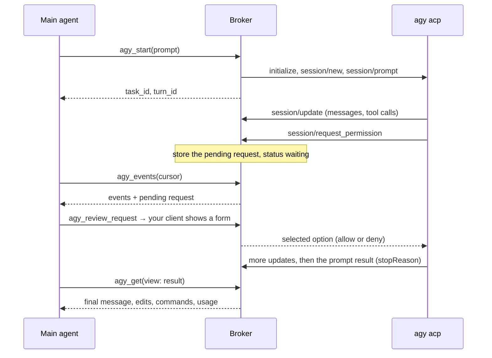

# Architecture

[Back to README](../README.md)

## Components

```text
MCP client (e.g. Claude Code)
    │  MCP JSON-RPC over stdin/stdout
    ▼
server.py serve            ── mcp.py, tools.py: handshake, tool schemas, validation, human review forms
    │  one JSON request per connection over a private Unix socket / Windows named pipe
    ▼
background broker          ── broker.py, ipc.py: lifecycle, identity, local transport
    │                         service.py, lifecycle.py, events.py, authority.py: tasks, turns, approvals
    │                         store.py: SQLite tasks, turns, requests, operation keys, event journal
    │  ACP (JSON-RPC 2.0) over the child's stdin/stdout, one process per task
    ▼
agy acp                    ── Antigravity CLI: your sign-in, models, permission engine, sandbox, tools
    │
    ▼
your project / Google's model service
```

Headless tasks (`engine: "headless"`) replace the long-running `agy acp` process with one `agy` print-mode process per turn (`--input-format stream-json --output-format stream-json`).

| Module | Responsibility |
|---|---|
| `cli.py` | Command line: `serve`, `start`, `stop`, `status`, `doctor`, `review`, `call`, `worktree`, `--version` |
| `mcp.py`, `tools.py` | The MCP stdio adapter (protocol negotiation, catalog, result encoding, review forms, cancellation of long polls) and the tool schemas with their argument checks |
| `broker.py`, `ipc.py` | Starting, finding and stopping the broker, its identity fingerprint, and the private local transport |
| `service.py` | Task operations: admission, folder reservations, live-session limit, idle close, controls, recovery, event polling |
| `lifecycle.py` | Task and turn states and their transitions, stop-reason mapping, reservations |
| `engine_acp.py`, `acp.py` | One ACP session per task: `initialize`, `session/new`/`resume`/`load`/`close`, prompts, steering, cancel, settings; ordered JSON-RPC with bounded frames |
| `headless.py` | The headless engine: argument whitelist, stream parser, outcome mapping, interrupts |
| `events.py` | Turning ACP updates and headless steps into journal events; coalescing text; deriving edits, commands, plans, subagents and background activity |
| `authority.py`, `schema.py` | Who may answer a request, validation of permission choices and question answers, review forms |
| `agy_cli.py` | Finding `agy`, its version and the read-only queries (`agy models`, `agy agents`, `/usage`, `/credits`, `/model`, `/effort`, `/skills`) |
| `worktrees.py` | The restricted Git helper for worktrees, handoff patches and diffs |
| `store.py` | SQLite persistence (WAL, schema version) and content-addressed artifacts |
| `config.py`, `contract.py` | Settings file, broker fingerprint, supported MCP/ACP/agy versions |
| `security.py`, `platforms.py`, `windows.py` | Paths, private files, redaction; OS-specific locking, processes, peer checks and named pipes |
| `diagnostics.py` | The checks behind `doctor` |

## Lifecycle

- The MCP client starts `server.py serve`. The handshake and `tools/list` work without starting anything else.
- The first tool call starts the broker, or connects to the running one. A startup lock prevents two brokers. The broker runs detached and survives the client.
- `agy_start` starts one `agy acp` process for the task, in the task's folder, with only documented flags (`--add-dir`, `--agent`, `--sandbox`, `--disable-telemetry`). The process stays open between turns, because the Antigravity agent may keep working after a turn ended (timers, subagents).
- On Windows every `agy` process runs in a Job Object, so a forced stop ends its whole process tree; on macOS and Linux it runs in its own process group. Every recorded process ID is stored with the process's start time, so a process ID reused after a reboot is not mistaken for the old `agy`.
- A quiet process is closed after `idle_close_minutes`, or earlier when the live-session limit needs room; the next `agy_send` reopens the conversation with `session/resume`, without replaying anything.
- `server.py stop` closes every session cleanly (`session/close`), marks running turns `interrupted`, and waits until the broker has exited.
- The broker records a fingerprint of its version and settings. A client with a different fingerprint is refused (`broker_identity_mismatch`), so an updated server never talks to an old broker.

## A turn, step by step



- **Questions** (`elicitation/create` forms) become pending requests the main agent can answer.
- **Steering** sends a second `session/prompt` while the first is running. Antigravity answers the first one at once with `end_turn` and finishes the work under the second; the server keeps one turn open while any prompt is outstanding.
- **Interrupt** sends `session/cancel`, answers open requests with `cancelled`, and waits for the prompt's `cancelled` result.
- **Background activity**: updates that arrive after the turn ended are journaled with `origin: "background"`; the task shows `activity: "background"` until it is quiet again.

The server never calls the main agent's model. The main agent polls `agy_events`, with `wait_seconds` up to 25.

## IDs and delivery guarantees

| ID | Meaning |
|---|---|
| `task_id` | The server's handle for one Antigravity conversation |
| `session_id` | Antigravity's own conversation ID (the same as `agy --conversation ID`) |
| `turn_id` | One round of work (`turn-1`, `turn-2`, …) |
| operation `request_id` | Duplicate protection for a call that changes something |
| pending `request_id` | One open question or permission prompt |
| event `cursor` | Position in the broker's event journal |

- Task state and the events that change it are committed to SQLite together, in one transaction.
- A repeated operation key returns the saved result. A call whose outcome is unknown is saved as `uncertain` and never repeated automatically.
- After a client reconnect, replay `agy_events` from the saved cursor; nothing is lost.
- After a broker restart, tasks whose process was alive become `needs_resume` and their pending requests expire. `agy_resume` reopens the conversation and reports what is known and unknown. Updates that `agy` sent while no broker listened cannot be recovered; `replay_history: true` rebuilds the conversation from Antigravity's own history.
- All callbacks run on the broker's event loop, so a slow call for one task never delays another task's interrupt or answer.
- Lines from `agy` are limited to 8 MiB; a longer line is dropped with a warning and the task's evidence is marked incomplete.
- Every tool result stays under 8 MiB. Long lists are paged and large content becomes an artifact read in pages.

## Why ACP

`agy acp` is the interface Google documents for editors and "other clients" that drive Antigravity CLI. It is the only documented interface with two-way permission prompts, questions, steering, cancellation, persistent sessions and their history. Alternatives were considered:

| Alternative | Why it is not the main engine |
|---|---|
| Headless mode (`agy -p`) | Documented and used for `engine: "headless"`, the read-only queries and structured output, but it cannot ask for permission (Antigravity denies such actions) and cannot be steered |
| The Antigravity Python SDK | Documented, but adds a dependency and its own runtime binary, and leases agents differently from the CLI the user signed in to |
| Driving the terminal UI | Screen scraping loses typed requests and decisions |
| Calling Google's model services directly | Not a documented interface, and it would use the sign-in outside the official program |

The message shapes the server expects were recorded from real `agy` 1.5.13 sessions; the offline test suite replays them with a scripted fake (`tests/fake_agy.py`).
